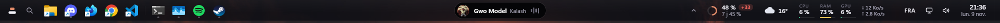
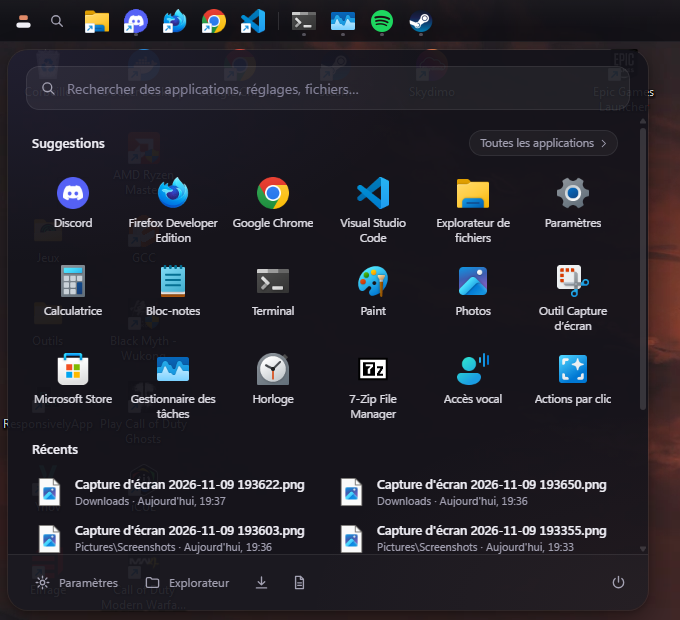
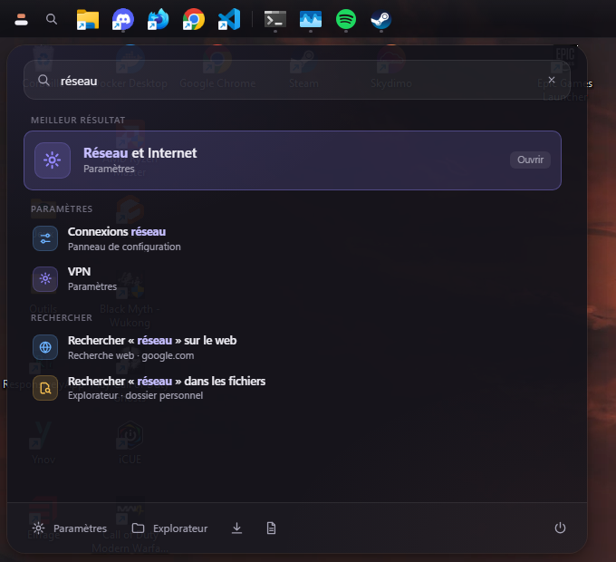
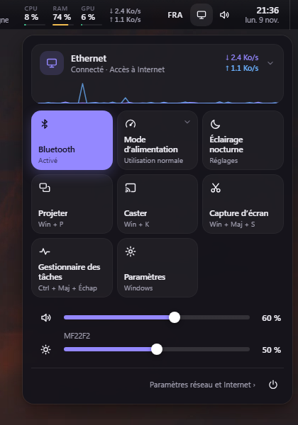
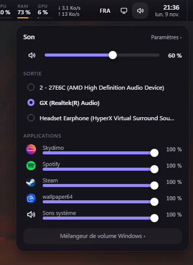
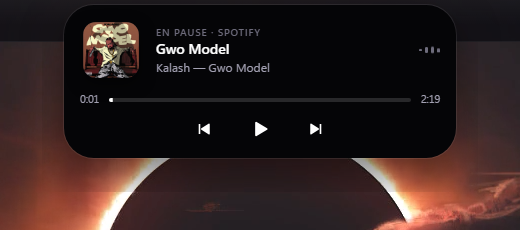

<div align="center">

# maxbar

**Une barre des tâches complète pour Windows 11, qui remplace celle de Windows de bout en bout.**
Menu Démarrer, recherche, paramètres rapides, son, réseau, musique, zone de notification : tout passe par maxbar.




</div>

maxbar est écrite en Rust avec [Tauri 2](https://tauri.app). L'interface est en HTML, CSS et JavaScript, sans framework ni étape de build.
Elle réserve sa place en haut (ou en bas) de l'écran comme la barre Windows, cache complètement cette dernière, et prend en charge tout ce qu'on allait y chercher.
Au repos, elle consomme environ **65 Mo de RAM** (WebView2 compris) et **moins de 1 % d'un cœur**. Dès qu'un jeu ou une vidéo passe en plein écran, elle s'efface et ses mesures s'arrêtent.

## Aperçu

| Menu Démarrer | Recherche |
|---|---|
|  |  |

| Paramètres rapides | Son | Musique |
|---|---|---|
|  |  |  |

## Fonctionnalités

### Menu Démarrer et recherche
Un seul lanceur, ouvert par le bouton Démarrer, la loupe ou **la touche Windows**.
- **Toutes les applications**, comme dans le menu Démarrer : apps de bureau et apps du Store (dossier shell `AppsFolder`).
  - Index mis en cache sur disque : l'ouverture est instantanée.
  - Mis à jour en arrière-plan.
- **Accueil** :
  - applications épinglées ou les plus utilisées ;
  - fichiers récents ;
  - liste A–Z ;
  - accès aux réglages, à l'Explorateur et au menu d'alimentation (verrouiller, veille, déconnexion, redémarrage, arrêt).
- **Recherche floue**, insensible aux accents, avec reconnaissance des initiales (`vsc` → Visual Studio Code). Les applications que tu lances souvent remontent en tête.
- **Ce qu'on peut trouver** :
  - applications ;
  - fenêtres ouvertes ;
  - plus de 50 pages de Paramètres et outils classiques (`ncpa.cpl`, gestionnaire de périphériques, services…) ;
  - fichiers récents.
- **Calculatrice intégrée** : `2*(3+4)` ou `sqrt(2)*10` ; Entrée copie le résultat.
- **Repli** : recherche web ou recherche dans les fichiers via l'Explorateur.
- **Clavier** :
  - ↑ ↓ pour naviguer, Entrée pour lancer ;
  - Ctrl+Maj+Entrée pour lancer en administrateur ;
  - Échap pour vider puis fermer ;
  - clic droit sur une app : emplacement du fichier, épingler, lancer en administrateur.

### Touche Windows
- Un appui seul sur <kbd>Win</kbd> ouvre le lanceur de maxbar au lieu du menu Démarrer, et <kbd>Win</kbd>+<kbd>S</kbd> ouvre la recherche.
- Toutes les autres combinaisons (<kbd>Win</kbd>+<kbd>E</kbd>, <kbd>Win</kbd>+<kbd>V</kbd>, <kbd>Win</kbd>+<kbd>Maj</kbd>+<kbd>S</kbd>, <kbd>Win</kbd>+<kbd>Tab</kbd>…) fonctionnent normalement.
- Le hook clavier est désinstallé pendant les jeux en plein écran.
- La fonction se désactive depuis le menu de l'icône maxbar.

### Réseau et paramètres rapides
Un clic sur l'icône réseau ouvre le panneau de maxbar, pas celui de Windows.
- **Connexion** :
  - Ethernet ou Wi-Fi, accès à Internet, débit en direct avec courbe ;
  - détails dépliables : IPv4/IPv6, passerelle, DNS, MAC, vitesse du lien.
- **Wi-Fi** (sur les PC qui en ont) : liste des réseaux, connexion avec mot de passe, déconnexion.
- **Tuiles** :
  - Wi-Fi et Bluetooth (vraies bascules radio) ;
  - mode d'alimentation ;
  - éclairage nocturne, projeter, caster, capture d'écran ;
  - gestionnaire des tâches, paramètres.
- **Curseurs** : volume, et luminosité des écrans externes par DDC/CI.

### Musique
- Un îlot au centre de la barre affiche le morceau en cours : Spotify, navigateurs, tout ce qui passe par les contrôles média de Windows.
- Les changements de morceau arrivent **instantanément**, par événements et non par interrogation. Ils sont animés : texte qui glisse, pochette en fondu, petite pulsation.
- Un clic déploie l'îlot : pochette, progression, contrôles. La molette règle le volume.

### Le reste de la barre
- **Applications** :
  - épingles importées de la barre Windows ;
  - fenêtres regroupées par application ;
  - clic molette pour une nouvelle fenêtre ;
  - clic droit pour la liste des fenêtres, épingler ou fermer.
- **Zone de notification** : maxbar héberge elle-même les icônes (Discord, Steam…) et leur transmet tous les clics.
- **Son** :
  - sortie audio et volume par application ;
  - molette sur l'icône pour le volume.
- **Clavier** : la disposition (FRA, ENU…) suit la fenêtre active ; un clic permet d'en changer.
- **Horloge** : un clic ouvre un volet avec calendrier et numéros de semaine, météo détaillée ([Open-Meteo](https://open-meteo.com), sans clé), volume et raccourcis.
- **Système** : CPU, RAM, GPU, réseau, batterie, avec 3 minutes d'historique.
- **Quota Claude Code** : fenêtres 5 h et 7 jours, consommation récente, rythme et projection.

## Installation

Prérequis : Windows 11, [Rust](https://rustup.rs) stable et les outils de build C++ de Visual Studio. WebView2 est fourni avec Windows 11.

```powershell
git clone https://github.com/MaxCtn/maxbar
cd maxbar\src-tauri
cargo build --release
.\target\release\maxbar.exe
```

Le CLI de Tauri n'est pas nécessaire : l'interface (`ui/`) est embarquée dans l'exécutable à la compilation.

Le menu de l'icône maxbar (zone de notification) propose :
- position haut ou bas ;
- masquage de la barre Windows ;
- touche Windows ;
- lancement au démarrage ;
- réimport des épingles ;
- édition de la configuration.

Si maxbar plante en ayant caché la barre Windows, la relancer puis la quitter proprement rétablit la barre. Redémarrer l'Explorateur marche aussi.

## Configuration

Le fichier est `%APPDATA%\maxbar\config.json`. Après modification, choisis « Recharger la configuration » dans le menu.

| Clé | Défaut | Rôle |
|---|---|---|
| `edge` | `"top"` | `"top"` ou `"bottom"` |
| `height` | `42` | Hauteur de la barre, en pixels logiques |
| `pinned` | épingles Windows | Exécutables, raccourcis `.lnk` ou URL épinglés |
| `opacity` | `0.72` | Opacité du fond (0 à 1) |
| `weather_city` | `""` | Ville pour la météo ; vide = position approximative par IP |
| `show_music`, `show_claude`, `show_system`, `show_weather` | `true` | Modules affichés |
| `clock_seconds` | `false` | Secondes dans l'horloge |
| `tray` | `true` | Héberger la zone de notification |
| `hide_windows_taskbar` | `true` | Cacher complètement la barre Windows |
| `win_key` | `true` | La touche Windows ouvre le lanceur de maxbar |
| `search_url` | Google | Moteur de la recherche web du lanceur (la requête est ajoutée à la fin) |

Le lanceur garde son index et ses statistiques d'usage à côté, dans `apps.json` et `launcher.json`.

### Quota Claude Code

maxbar lit `%USERPROFILE%\.claude\monitor\quota.json`, écrit par une [statusline](https://docs.claude.com/en/docs/claude-code/statusline) de Claude Code. Le fichier reprend le champ `rate_limits` transmis à la statusline, avec un horodatage :

```json
{
  "rate_limits": {
    "five_hour": { "used_percentage": 12.5, "resets_at": 1762712400 },
    "seven_day": { "used_percentage": 40, "resets_at": 1763000000 }
  },
  "_ts": 1762700000
}
```

Sans ce fichier, le module affiche simplement « aucune donnée ».

## Comment ça marche

```
src-tauri/src/
  main.rs      commandes appelées par l'interface, menu de l'icône, configuration
  appbar.rs    réservation de l'écran, région de fenêtre, plein écran, barre Windows cachée
  launcher.rs  index des applications (AppsFolder), fichiers récents, lancement, alimentation
  winkey.rs    touche Windows (hook clavier bas niveau)
  network.rs   cartes réseau, connectivité, Wi-Fi (wlanapi)
  quick.rs     radios Wi-Fi/Bluetooth, luminosité DDC/CI, modes d'alimentation
  media.rs     lecture en cours, par événements (GlobalSystemMediaTransportControls)
  tray.rs      hôte de la zone de notification
  tasks.rs     fenêtres ouvertes et épingles
  audio.rs     volume, sorties, volume par application (Core Audio)
  keyboard.rs  dispositions du clavier
  stats.rs     CPU, RAM, GPU (PDH), réseau, batterie
  weather.rs   météo · claude.rs quota Claude · config.rs configuration
  icons.rs     icônes en PNG · sys.rs utilitaires Win32
ui/            index.html, style.css, app.js, launcher.*, quick.*
```

Quelques choix qui ne sautent pas aux yeux :

- **Fenêtre et clics.** La fenêtre couvre tout l'écran, mais une région Win32 (`SetWindowRgn`) ne garde visibles et cliquables que la barre et les panneaux ouverts. Ailleurs, les clics atteignent les fenêtres du dessous.
- **Touche Windows.** Pour que Windows n'ouvre pas son menu, une frappe factice est glissée juste avant le relâchement de <kbd>Win</kbd> : Windows croit alors à une combinaison. C'est la technique de PowerToys.
- **Toutes les applications.** Le lanceur énumère le dossier shell `AppsFolder`, la source exacte de la liste du menu Démarrer. Chaque app est lancée via `shell:AppsFolder\<id>`, qu'elle vienne du Store ou non.
- **Zone de notification.** maxbar crée une fenêtre de classe `Shell_TrayWnd`, comme [Zebar](https://github.com/glzr-io/zebar). Les applications lui envoient leurs icônes, et chaque message est relayé à l'Explorateur.
- **Sortie audio.** Elle se change via `IPolicyConfig`, une interface non documentée mais stable, celle qu'utilise le panneau Son de Windows.
- **Zéro impact en jeu.** En plein écran, la WebView est rendue invisible (elle ne dessine plus) et le hook clavier est retiré. Les mesures et interrogations sont suspendues.

## Limites connues

- Le centre de notifications (<kbd>Win</kbd>+<kbd>N</kbd>, clic droit sur l'horloge) reste celui de Windows. Lire les notifications des autres apps exige une identité de package.
- Pas d'interrupteur pour l'éclairage nocturne ni pour « Ne pas déranger » : Windows n'a pas d'API publique pour ça. Les tuiles ouvrent la page de réglages.
- La luminosité ne marche qu'avec les écrans qui acceptent le DDC/CI.
- Un seul écran pour l'instant.

## Inspirations

Ces projets ont servi de référence d'idées et de techniques. Aucun code n'a été repris des projets sous licence GPL ou AGPL.
- [PowerToys](https://github.com/microsoft/PowerToys) (MIT) : touche factice du Keyboard Manager, mise au premier plan de FancyZones, PowerToys Run.
- [Flow Launcher](https://github.com/Flow-Launcher/Flow.Launcher) (MIT) et Raycast : l'ergonomie du lanceur.
- [EarTrumpet](https://github.com/File-New-Project/EarTrumpet) (MIT) : le volume par application.
- [YASB](https://github.com/amnweb/yasb) (MIT), [Zebar](https://github.com/glzr-io/zebar) et [Seelen UI](https://github.com/eythaann/Seelen-UI) : barres alternatives pour Windows.

## Développement

Pour inspecter l'interface pendant que maxbar tourne :

```powershell
$env:WEBVIEW2_ADDITIONAL_BROWSER_ARGUMENTS = "--remote-debugging-port=9333"
.\target\release\maxbar.exe
```

Ouvre ensuite `edge://inspect`.

Windows verrouille l'exécutable en cours d'utilisation. Pour recompiler sans quitter maxbar, renomme-le d'abord (`maxbar.exe` → `maxbar.exe.old`).
